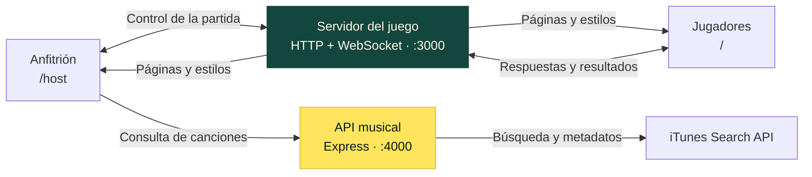

<div align="center">

# HITSTERHOOT

### Escucha la canción. Encuentra el año. Sube en la clasificación.

Un juego musical multijugador para compartir pantalla, competir desde el celular
y poner a prueba tu memoria musical.


**[El juego](#el-juego) · [Inicio rápido](#inicio-rápido) · [Arquitectura](#arquitectura) · [Configuración](#configuración) · [API musical](#api-musical)**

</div>

---

## El juego

Una canción empieza a sonar. Todos la reconocen. Pero, ¿de qué año es?

**HITSTERHOOT** lleva esa pregunta a una partida en tiempo real. El anfitrión reproduce la música y comparte la sala; cada participante responde desde su navegador. La cercanía al año correcto determina los puntos, y la clasificación se actualiza después de cada ronda.

Sin cuentas ni aplicaciones que instalar para los jugadores: una dirección, un código de sala y un nombre son suficientes para entrar.

| Una pantalla compartida | Un control por jugador | Una clasificación en vivo |
| --- | --- | --- |
| El anfitrión reproduce las canciones y presenta los resultados. | Cada participante elige y envía un año desde su dispositivo. | El servidor calcula los puntos y actualiza las posiciones. |

## Qué incluye

- Salas identificadas mediante un código de cuatro dígitos.
- Interfaces independientes para anfitrión y jugadores.
- Acceso desde el navegador, sin registro de cuentas.
- Partidas de 3, 5, 10 o 15 rondas desde la interfaz.
- Respuestas mediante un deslizador de años y controles de ajuste.
- Tiempo de respuesta configurable, con 20 segundos por defecto.
- Una respuesta por participante y ronda.
- Finalización anticipada de la ronda cuando todos responden.
- Puntuación calculada en el servidor según la diferencia de años.
- Resultados individuales, clasificación acumulada y resultado final.
- Revancha con los participantes conectados.
- Control de canciones repetidas durante la partida, con reintentos limitados.
- Tema visual inspirado en vinilos y décadas musicales, con soporte para movimiento reducido en las animaciones principales.

## Tecnologías

| Tecnología | Responsabilidad |
| --- | --- |
| Node.js | Ejecución de los servicios y servidor HTTP del juego |
| ws | Comunicación WebSocket y eventos de la partida |
| Express | API HTTP de conjuntos musicales y canciones |
| cors | Configuración de acceso a la API desde otro origen |
| JavaScript | Interfaz, reproducción de audio, eventos y temporizadores |
| HTML y CSS | Estructura de las pantallas y tema compartido |
| iTunes Search API | Búsqueda de canciones, fechas y fragmentos de audio |

## Arquitectura

Dos servicios separan la lógica de la partida de la búsqueda musical. La interfaz utiliza HTML, CSS y JavaScript nativo; las salas y puntuaciones se mantienen en memoria.



| Servicio | Puerto predeterminado | Responsabilidad |
| --- | --- | --- |
| Servidor del juego | `3000` | Páginas, archivos estáticos, salas, rondas y puntuación |
| API musical | `4000` | Conjuntos disponibles y selección de canciones |

### Recorrido de una ronda

1. El navegador del anfitrión solicita una canción a la API musical.
2. Inicia la reproducción del fragmento y envía los datos al servidor del juego.
3. El servidor abre la ronda y comunica el tiempo disponible a los jugadores.
4. Cada participante envía un año mediante WebSocket.
5. El servidor cierra la ronda, calcula los puntos y distribuye los resultados.

El mensaje de inicio que reciben los jugadores no contiene el título, el artista ni el año correcto. La validación de respuestas y el cálculo de puntuación se realizan en el servidor.

### Estructura del proyecto

```text
hitsterhoot/
├── app/
│   ├── public/
│   │   └── styles/
│   │       └── theme.css          # Tema visual y animaciones
│   └── views/
│       ├── client.html        # Interfaz de los jugadores
│       └── host.html          # Sala y control del anfitrión
├── server/
│   ├── api.js                 # API musical con Express
│   ├── ws-server.js           # HTTP, WebSockets y reglas
│   └── utils/
│       └── itunes.js          # Catálogo y selección de canciones
├── .gitignore
├── package-lock.json
├── package.json
└── README.md
```

| Archivo | Responsabilidad |
| --- | --- |
| `client.html` | Acceso a la sala, selección del año y resultados personales |
| `host.html` | Configuración, reproducción y presentación de la partida |
| `theme.css` | Tema visual y animaciones compartidas |
| `ws-server.js` | Servidor HTTP, conexiones WebSocket y reglas del juego |
| `api.js` | Endpoints de la API musical |
| `itunes.js` | Definición de conjuntos y búsqueda de canciones |

---

## Inicio rápido

### Requisitos

- Node.js 22 o superior.
- npm.
- Navegador con soporte para WebSocket y reproducción de audio.
- Conexión a internet para consultar iTunes y reproducir los fragmentos.

### 1. Instalar el proyecto

```bash
git clone https://github.com/Emilianox-creator/hitsterhoot.git
cd hitsterhoot
npm ci
```

### 2. Iniciar los servicios

Inicia la API musical en una terminal:

```bash
node server/api.js
```

En una segunda terminal, inicia el servidor del juego:

```bash
node server/ws-server.js
```

Ambos procesos deben permanecer activos durante la partida.

| Pantalla | Dirección |
| --- | --- |
| Anfitrión | [http://localhost:3000/host](http://localhost:3000/host) |
| Jugadores | [http://localhost:3000/](http://localhost:3000/) |

### Desarrollo con recarga automática

Los scripts disponibles son:

```bash
npm run api
npm run ws
```

Estos scripts requieren `nodemon` disponible en el entorno. Para ejecutar la aplicación únicamente con las dependencias del proyecto, utiliza los comandos directos con `node`.

---

## Cómo jugar

### Anfitrión

1. Abre `/host` en el dispositivo que reproducirá el audio.
2. Comparte la dirección del juego y el código de sala.
3. Espera a que se incorporen los participantes.
4. Selecciona el conjunto musical y el número de rondas.
5. Pulsa **Empezar partida**.

La pantalla del anfitrión muestra el temporizador, las respuestas recibidas y la clasificación. Si el navegador bloquea el audio, utiliza **Tocar para reproducir**.

### Jugadores

1. Abre la dirección del juego en tu navegador.
2. Introduce el código de sala y tu nombre.
3. Escucha la canción reproducida por el anfitrión.
4. Selecciona un año y envía la respuesta antes de que termine el tiempo.
5. Consulta los puntos obtenidos y tu posición al finalizar la ronda.

El audio se reproduce en el dispositivo del anfitrión. Los dispositivos de los participantes funcionan como controles de respuesta.

### Acceso desde la red local

Para jugar desde celulares u otras computadoras, utiliza la IP local del equipo que ejecuta los servicios en lugar de `localhost`.

Por ejemplo, si la IP del servidor es `192.168.1.50`:

```text
Anfitrión: http://192.168.1.50:3000/host
Jugadores: http://192.168.1.50:3000/
```

Los dispositivos deben tener acceso al servidor del juego. El navegador del anfitrión también debe poder acceder a la API musical en el puerto `4000`, salvo que se configure otra dirección.

## Puntuación

Cada jugador puede enviar una respuesta por ronda. Se aceptan años enteros comprendidos entre 1900 y el año actual.

> **1,000 puntos por el año exacto.** Cada año de diferencia descuenta 50 puntos, sin puntuaciones negativas.

La fórmula aplicada por el servidor es:

```text
puntos = max(0, 1000 - abs(respuesta - año correcto) × 50)
```

| Diferencia | Puntos |
| --- | ---: |
| Año exacto | 1,000 |
| 1 año | 950 |
| 5 años | 750 |
| 10 años | 500 |
| 19 años | 50 |
| 20 años o más | 0 |
| Sin respuesta | 0 |

No se otorgan bonificaciones por velocidad. La ronda termina cuando vence el plazo o todos los participantes han respondido.

La clasificación se ordena por puntuación acumulada y, en caso de empate, por nombre. La pantalla final del anfitrión identifica los empates en el primer lugar.

Después de mostrar los resultados, la partida avanza automáticamente: ocho segundos entre rondas y doce segundos antes de la pantalla final. El anfitrión puede adelantar estas transiciones mediante el botón correspondiente.

---

## Configuración

Los servicios leen las siguientes variables de entorno:

| Variable | Valor predeterminado | Descripción |
| --- | --- | --- |
| `PORT` | `3000` | Puerto del servidor del juego |
| `API_PORT` | `4000` | Puerto de la API musical |
| `GUESS_SECONDS` | `20` | Duración de la ventana de respuesta, en segundos |
| `ROUNDS` | `5` | Rondas de respaldo cuando la solicitud de inicio no incluye una selección válida |
| `ALLOWED_ORIGIN` | Origen de la petición | Origen permitido por CORS en la API |

La selección enviada por la interfaz tiene prioridad sobre `ROUNDS`. El protocolo del servidor admite entre 1 y 30 rondas; la interfaz ofrece 3, 5, 10 y 15.

### Ejemplo en PowerShell

Terminal de la API:

```powershell
$env:API_PORT = "4000"
$env:ALLOWED_ORIGIN = "http://localhost:3000"
node server/api.js
```

Terminal del juego:

```powershell
$env:PORT = "3000"
$env:GUESS_SECONDS = "30"
node server/ws-server.js
```

La configuración se toma del entorno del proceso. Los archivos `.env` no se cargan automáticamente.

### Dirección de la API

Por defecto, la pantalla del anfitrión utiliza el protocolo y hostname de la página, con el puerto `4000`. Para apuntar a otra dirección, utiliza el parámetro `api`:

```text
http://localhost:3000/host?api=http://localhost:4500
```

En un entorno con HTTPS, la API debe estar disponible mediante HTTPS. La conexión WebSocket utiliza `ws` o `wss` según el protocolo de la página.

## API musical

### `GET /sets`

Devuelve los conjuntos musicales disponibles. Actualmente se incluye `mezcla`:

```json
[
  {
    "id": "mezcla",
    "label": "Mezcla de todo",
    "desc": "Varias décadas, mayormente en inglés"
  }
]
```

### `GET /random-song`

Selecciona una canción aleatoria del conjunto indicado. Si se omite `set`, utiliza `mezcla`.

```http
GET /random-song?set=mezcla
```

Ejemplo ilustrativo de respuesta:

```json
{
  "id": 123456789,
  "name": "Título de la canción",
  "artist": "Nombre del artista",
  "year": 1990,
  "previewUrl": "https://example.com/preview.m4a"
}
```

| Estado | Descripción |
| --- | --- |
| `200` | Canción obtenida |
| `400` | Identificador de conjunto desconocido |
| `502` | Error al obtener una canción |

### Selección del catálogo

Los conjuntos se definen en `server/utils/itunes.js`. Cada conjunto admite una etiqueta, descripción, lista de artistas, tienda de iTunes y límites opcionales de año.

La selección filtra resultados sin audio o fecha, comprueba el nombre del artista y excluye coincidencias con términos de recopilaciones, karaoke y tributos. El año de referencia se obtiene de `releaseDate`; puede corresponder a la edición disponible en el catálogo y no necesariamente al lanzamiento original de la grabación.

## Comportamiento de las salas

- Las salas, respuestas y puntuaciones se eliminan al reiniciar el servidor.
- Los participantes solo pueden incorporarse mientras la sala está en el lobby.
- Los nombres de jugador son únicos dentro de cada sala, sin distinguir mayúsculas y minúsculas.
- La desconexión del anfitrión cierra la sala.
- La desconexión de un jugador lo elimina de la partida; no hay recuperación automática de su sesión.
- La reproducción depende de la disponibilidad del catálogo y de las políticas de audio del navegador.
- La selección de canciones sigue un modelo de anfitrión de confianza: su navegador obtiene y comunica los datos de cada canción.

## Solución de problemas

| Situación | Comprobación |
| --- | --- |
| No se cargan los conjuntos | Verifica que la API esté activa y que su dirección sea accesible |
| El botón de inicio está deshabilitado | Debe haber un jugador conectado y un conjunto musical cargado |
| El audio no comienza | Utiliza **Tocar para reproducir** cuando aparezca |
| Falla la búsqueda de canción | Comprueba la conexión y pulsa **Reintentar** |
| Otro dispositivo no accede al juego | Utiliza la IP del servidor y comprueba el acceso al puerto |
| No se puede entrar a una sala | Confirma el código y que la partida no haya comenzado |
| Un script no encuentra `nodemon` | Ejecuta el servicio con su comando directo de Node.js |

---

<div align="center">

**HITSTERHOOT** · Loera Labs

*Música, memoria y competencia en tiempo real.*

[Volver al inicio](#hitsterhoot)

</div>
